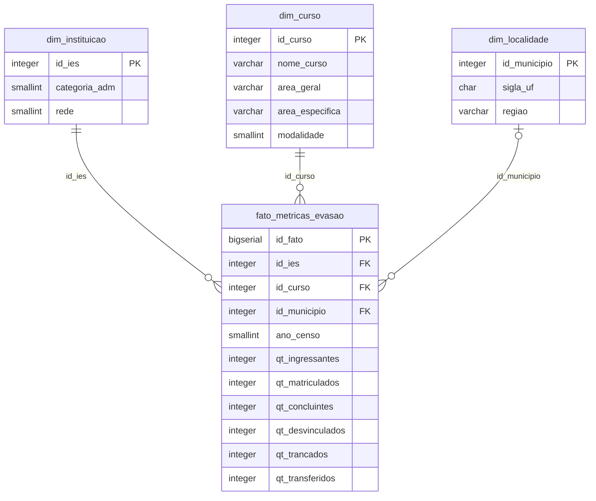
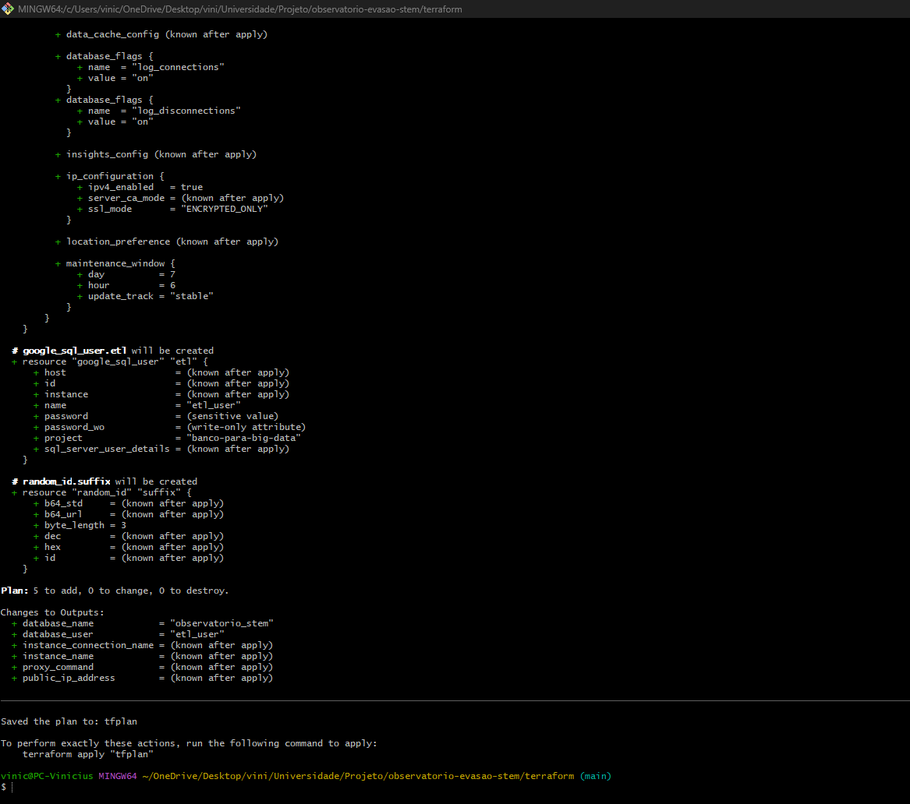
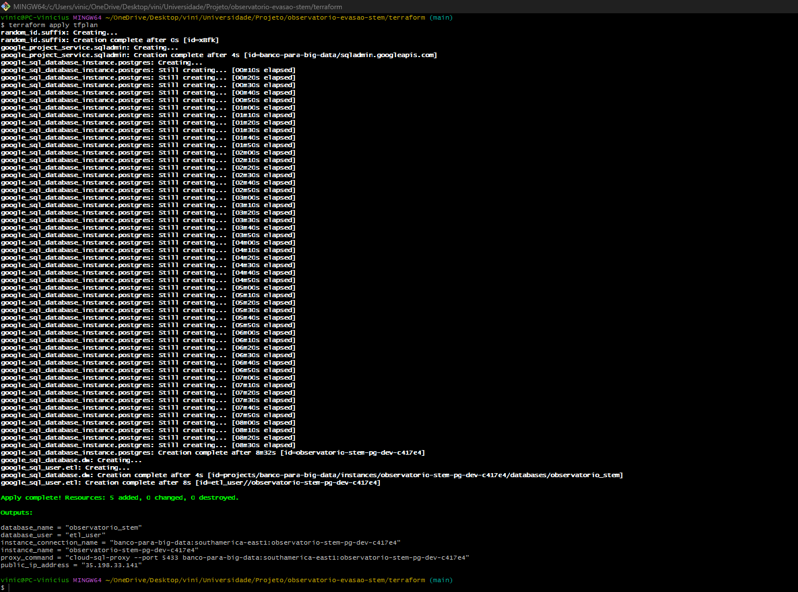
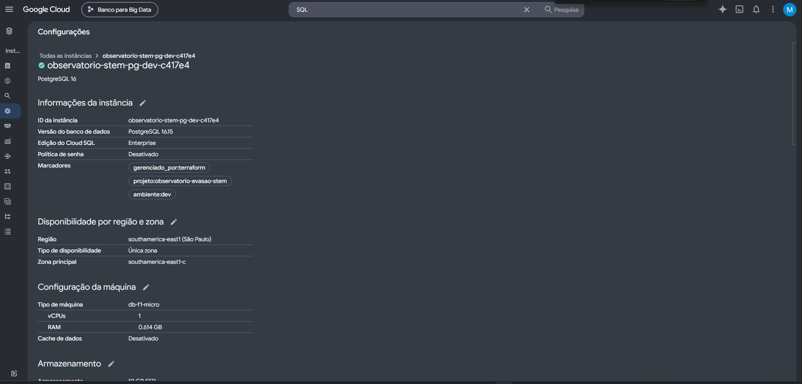
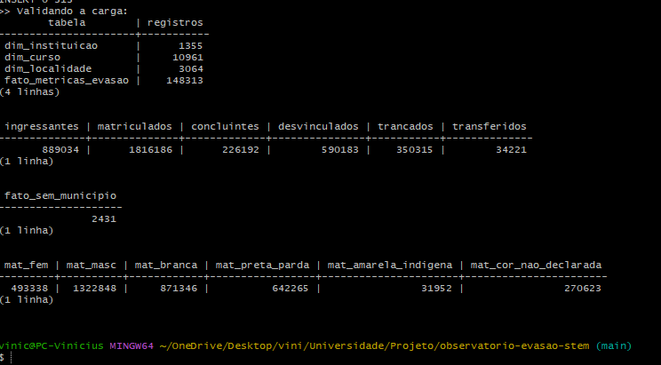

# Observatório de Evasão e Retenção em Cursos STEM

Projeto da disciplina de Big Data e Analytics (UCSAL). O objetivo é acompanhar a evasão e a retenção nos cursos de graduação das áreas de ciência, tecnologia, engenharia e matemática (STEM) no Brasil, olhando também para gênero e raça (ODS 5 e 18).

Este README documenta a etapa de preparação dos dados: tratamento, modelagem, banco de dados na nuvem e infraestrutura com Terraform.

## Dados utilizados

**Fonte:** Censo da Educação Superior, publicado pelo INEP.

**Base:** arquivo `MICRODADOS_CADASTRO_CURSOS_2024.CSV`, que vem dentro do pacote [microdados_censo_da_educacao_superior_2024.zip](https://download.inep.gov.br/microdados/microdados_censo_da_educacao_superior_2024.zip).

**Período:** ano de 2024.

**Recorte:** só os cursos das três áreas STEM da classificação CINE (coluna `NO_CINE_AREA_GERAL`):

- Computação e Tecnologias da Informação e Comunicação (TIC)
- Engenharia, produção e construção
- Ciências naturais, matemática e estatística

**Características da base:**

- O arquivo original tem 720.349 linhas, 223 colunas e 431 MB, com todas as áreas do conhecimento.
- Depois do recorte ficaram 148.313 linhas, de 10.961 cursos, 1.355 instituições e 3.064 municípios.
- Cada linha é um curso em um município. Por isso os cursos EaD aparecem várias vezes, uma para cada polo, e 94% das linhas são de EaD.
- 2.431 linhas de cursos EaD não têm município informado.
- Os dados já vêm agregados (quantidade de alunos por curso). Não existe nenhuma informação pessoal de aluno, o que facilita a conformidade com a LGPD.
- O INEP informa sexo e cor/raça para ingressantes, matriculados e concluintes, mas não para os alunos desvinculados. Então a análise de gênero e raça precisa ser feita sobre ingresso, matrícula e conclusão.

**Colunas que usamos:**

- Identificação: `NU_ANO_CENSO`, `CO_IES`, `TP_CATEGORIA_ADMINISTRATIVA`, `TP_REDE`, `CO_CURSO`, `NO_CURSO`, `NO_CINE_AREA_GERAL`, `NO_CINE_AREA_ESPECIFICA`, `TP_MODALIDADE_ENSINO`
- Localidade: `SG_UF`, `CO_MUNICIPIO`, `NO_REGIAO`
- Fluxo de alunos: `QT_ING` (ingressantes), `QT_MAT` (matriculados), `QT_CONC` (concluintes), `QT_SIT_DESVINCULADO` (desvinculados, nossa medida de evasão), `QT_SIT_TRANCADA` (trancados), `QT_SIT_TRANSFERIDO` (transferidos)
- Perfil: as mesmas contagens de ingressantes, matriculados e concluintes separadas por sexo (`_FEM`, `_MASC`) e por cor/raça (`_BRANCA`, `_PRETA`, `_PARDA`, `_AMARELA`, `_INDIGENA`, `_CORND`)

## Tratamento realizado

Na etapa anterior o tratamento foi feito no Power Query do Excel (o arquivo está em `etl/power_query/filtro_stem.pq`). Nesta etapa refizemos o processo em Python, por dois motivos: incluir as colunas de gênero e raça, que tinham ficado de fora, e deixar o processo reproduzível sem depender do Excel. Conferimos que as duas versões geram as mesmas 148.313 linhas e os mesmos totais.

O tratamento está em `etl/python/tratar_base.py` e faz o seguinte:

1. Lê o CSV direto de dentro do arquivo .zip, sem precisar descompactar.
2. Lê em blocos de 50 mil linhas, para não carregar os 431 MB inteiros na memória.
3. Mantém só as 42 colunas que vamos usar.
4. Filtra as três áreas STEM.
5. Troca valores vazios nas colunas de quantidade por 0. No Censo, campo vazio significa que não havia aluno naquela situação.
6. Converte as quantidades para número inteiro e remove linhas duplicadas.
7. Salva o resultado em `data/processed/base_tratada_stem.csv`.

Depois, o `etl/python/gerar_sql.py` separa a base nas tabelas do banco e gera o arquivo de carga `sql/02_carga_dados.sql`.

Problemas que encontramos e o que decidimos:

- **Cursos EaD sem município.** A primeira versão do conversor descartava essas linhas, e o total de 161.268 registros informado na etapa anterior somava todas as tabelas já sem elas. Decidimos mantê-las com o município vazio para não perder alunos de EaD.
- **Encoding.** O arquivo do INEP usa Latin-1. Lemos nesse formato e gravamos em UTF-8 para não quebrar os acentos. Na carga pelo Windows, o `psql` também precisou ser configurado para UTF-8.
- **Desempenho da carga.** Gerar um INSERT por linha deixaria a carga muito lenta pela conexão com a nuvem. Agrupamos em blocos de mil linhas, o que reduziu de cerca de 150 mil para 166 comandos.
- **Reexecução.** O script de carga apaga os dados antes de inserir, para poder ser rodado de novo sem duplicar nada.

A base tratada está disponível no [Google Drive](https://drive.google.com/drive/folders/1pMj6MbXb8mXnZ831nP1RrQ1Kk_GOLuFa?usp=sharing).

## Modelagem

Usamos um modelo estrela (Star Schema), com uma tabela fato no centro e três tabelas de dimensão.

Escolhemos esse modelo porque o objetivo do projeto é análise: somar e comparar números por área, rede, modalidade e região. Nele, os nomes de cursos, áreas e regiões ficam guardados uma vez só nas dimensões, e a tabela fato guarda só números e chaves. Isso ocupa menos espaço no banco e deixa as consultas mais rápidas. Também é o formato que ferramentas de dashboard esperam, o que ajuda na próxima fase.



Além das colunas do diagrama, a fato tem mais 24 colunas inteiras com o perfil dos alunos, no formato `qt_{ing|mat|conc}_{fem|masc|branca|preta|parda|amarela|indigena|cornd}`.

| Tabela | Registros |
| --- | ---: |
| dim_instituicao | 1.355 |
| dim_curso | 10.961 |
| dim_localidade | 3.064 |
| fato_metricas_evasao | 148.313 |

Os códigos do INEP (rede, categoria e modalidade) foram guardados como números pequenos (`SMALLINT`) em vez de texto. A coluna `id_municipio` aceita vazio por causa dos cursos EaD sem município. Há índices nas chaves da fato para acelerar as junções.

O script completo de criação está em `sql/01_ddl_star_schema.sql`.

## Infraestrutura

O banco está no **Google Cloud SQL**, com **PostgreSQL 16**, e foi criado inteiramente pelo **Terraform** (pasta `terraform/`).

O que o Terraform cria:

- ativa a API do Cloud SQL no projeto;
- uma instância PostgreSQL 16, edição Enterprise, máquina `db-f1-micro` (a menor disponível), em São Paulo (`southamerica-east1`), com disco SSD de 10 GB que pode crescer até 20 GB e backup diário;
- o banco `observatorio_stem`;
- o usuário `etl_user`, usado pela carga.

Escolhemos a menor máquina porque a base tem cerca de 150 mil linhas e ocupa pouco espaço, e o projeto precisa ter custo baixo. São Paulo foi escolhida por ser a região mais próxima.

Tecnologias usadas: Python 3 com pandas, PostgreSQL 16, Google Cloud SQL, Terraform, Cloud SQL Auth Proxy e Git.

### Segurança

Nenhuma senha ou chave está no repositório:

- A senha do banco é passada ao Terraform por variável de ambiente (`TF_VAR_db_password`) e fica marcada como sensível, então não aparece nas saídas.
- Os arquivos com dados reais (`.env`, `terraform.tfvars` e `terraform.tfstate`) estão no `.gitignore`. No repositório ficam só os modelos `.env.example` e `terraform.tfvars.example`, sem valores.
- O acesso ao Google Cloud é feito com o login do `gcloud`, sem arquivo de chave.
- O banco não aceita conexões abertas da internet. O acesso é feito pelo Cloud SQL Auth Proxy, que autentica pela conta Google e criptografa a conexão. A instância também só aceita conexões criptografadas.

Mais detalhes em `docs/SEGURANCA.md`.

## Execução

Ferramentas necessárias:

- Python 3 com pandas (`pip install pandas`)
- Google Cloud CLI (`gcloud`)
- Terraform 1.5 ou superior
- Cloud SQL Auth Proxy
- Cliente `psql`
- Uma conta no Google Cloud com faturamento ativo

No Windows, os comandos abaixo foram rodados no Git Bash.

**1. Tratar os dados.** Baixe o zip do INEP, coloque em `data/raw/` e rode:

```bash
python etl/python/tratar_base.py
python etl/python/gerar_sql.py
```

**2. Fazer login no Google Cloud.**

```bash
gcloud auth login
gcloud auth application-default login
gcloud config set project ID_DO_PROJETO
```

**3. Preparar a senha e as configurações.**

```bash
cp .env.example .env
cp terraform/terraform.tfvars.example terraform/terraform.tfvars
```

Coloque o ID do projeto no `terraform.tfvars` e uma senha forte no `PGPASSWORD` do `.env`. Depois:

```bash
export TF_VAR_db_password=$(grep PGPASSWORD .env | cut -d= -f2)
```

**4. Criar a infraestrutura.**

```bash
cd terraform
terraform init
terraform plan -out=tfplan
terraform apply tfplan
```

A criação da instância leva cerca de 10 minutos.

**5. Abrir a conexão com o banco** em outro terminal, deixando-o aberto:

```bash
cloud-sql-proxy --port 5433 $(terraform output -raw instance_connection_name)
```

**6. Criar as tabelas, carregar e validar.**

```bash
cd ..
bash scripts/carregar_dados.sh
```

O script cria as tabelas, faz a carga e roda `sql/03_validacao.sql`, que mostra a quantidade de registros de cada tabela e os totais.

Para desligar tudo depois: `terraform destroy` dentro da pasta `terraform`.

## Resultado da carga

A validação no banco bateu com a base tratada:

- 148.313 linhas na tabela fato;
- 1.816.186 matrículas, 889.034 ingressantes, 226.192 concluintes e 590.183 desvinculados;
- 493.338 matrículas de mulheres (27%) e 642.265 de pessoas pretas e pardas (35%).

Algumas consultas de teste feitas no banco. A taxa de evasão foi calculada como desvinculados dividido por matriculados no ano:

- Por área: TIC tem a maior taxa (37,8%), seguida de Engenharia (28,9%) e Ciências naturais (24,3%).
- Por rede e modalidade: o EaD privado chega a 47,1%, contra 16,8% no presencial público.
- Por estado: Rondônia (41,6%) e Amazonas (40,5%) têm as maiores taxas; Paraíba e Rio Grande do Norte (26,1%), as menores.

### Evidências

Plano do Terraform (5 recursos a criar):



Criação da infraestrutura:



Instância no console do Google Cloud, com os marcadores colocados pelo Terraform:



Validação da carga:



Os outros prints (inicialização do Terraform, lista de instâncias, conexão pelo proxy e as consultas) estão em [docs/evidencias](docs/evidencias).

## Estrutura do repositório

```text
data/raw/          microdados do INEP (não versionado)
data/processed/    base tratada (não versionada)
etl/python/        tratamento e geração da carga
etl/power_query/   versão anterior do tratamento, no Excel
sql/               criação das tabelas e validação
scripts/           script de carga no banco
terraform/         infraestrutura do banco no Google Cloud
docs/              segurança e evidências
```
