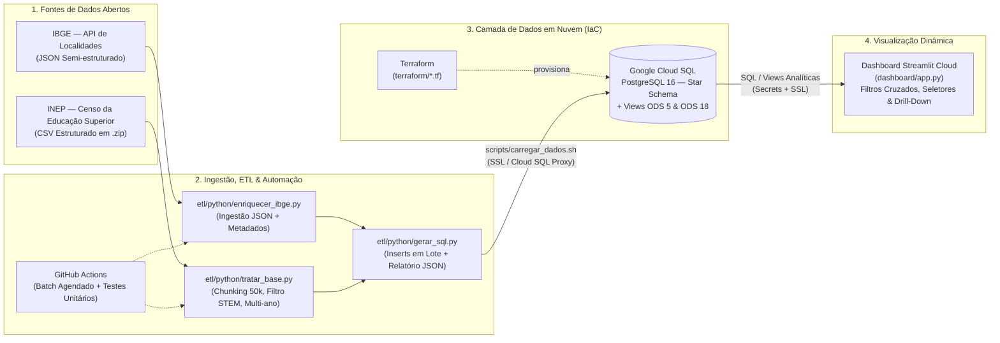
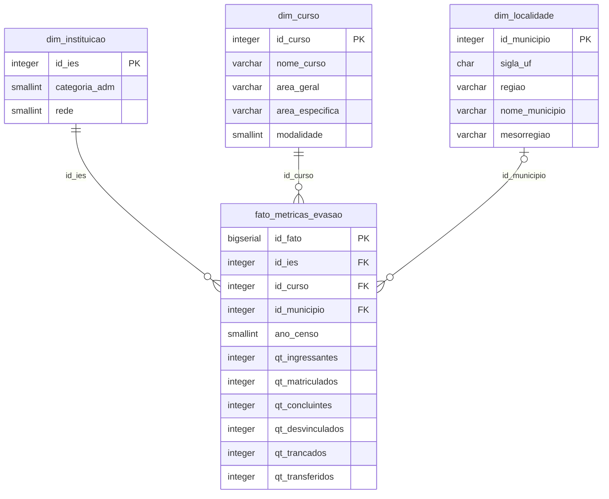
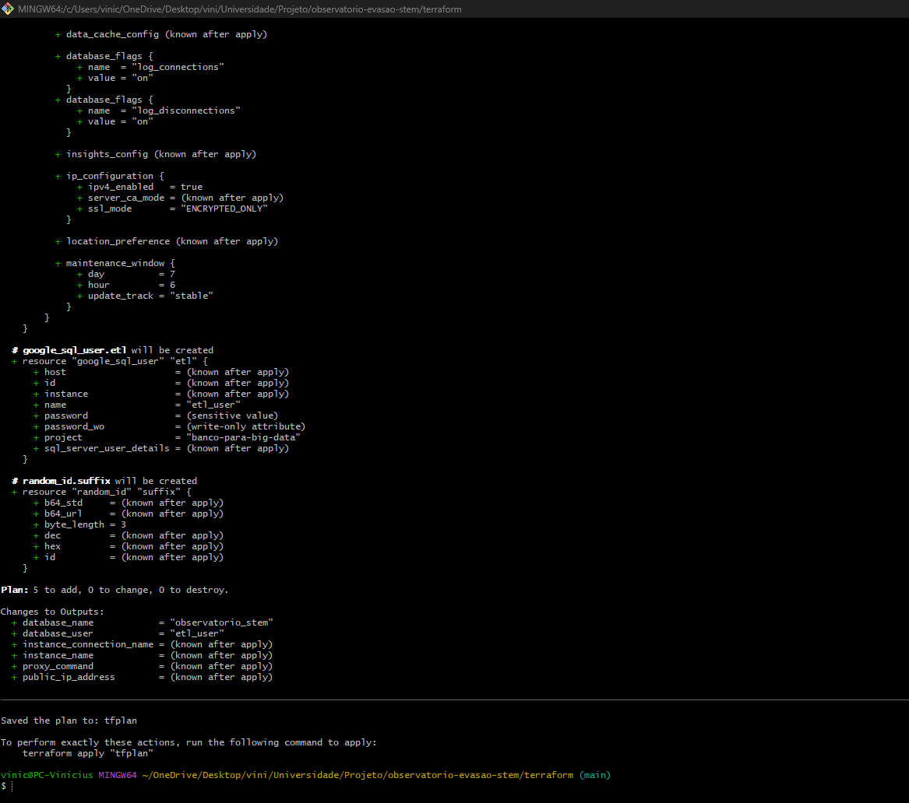
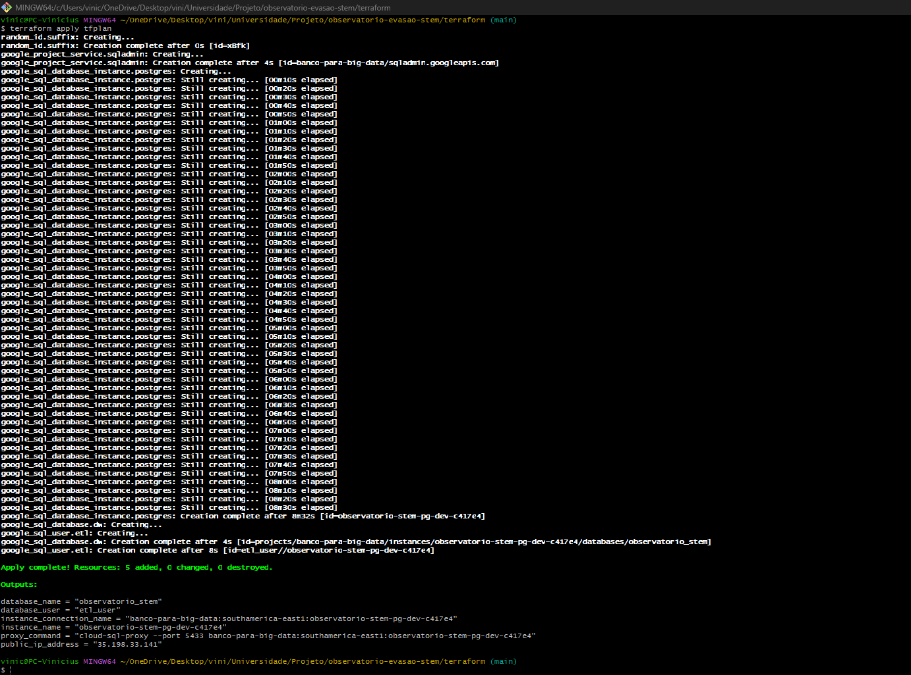
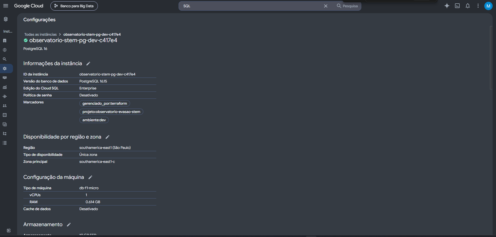
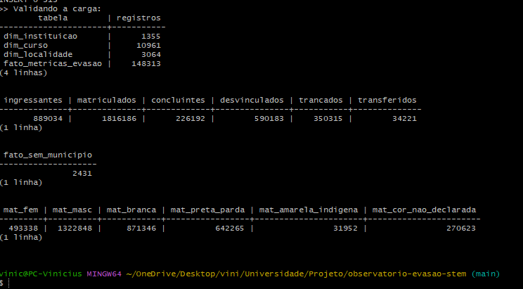

# Observatório de Evasão e Retenção em Cursos STEM

Projeto prático da disciplina de **Big Data e Analytics (UCSAL)** focado no acompanhamento da evasão, retenção e equidade socioeconômica nos cursos de graduação das áreas de Ciência, Tecnologia, Engenharia e Matemática (**Área 1 — STEM**) no Brasil, com alinhamento direto às **ODS 5 (Igualdade de Gênero)** e **ODS 18 (Igualdade Étnico-Racial)**.

O pipeline cobre todo o ciclo de vida de Engenharia e Análise de Big Data em nuvem: **Negócio & LGPD ➔ Ingestão & Tipagem ➔ ETL & Tratamento ➔ Modelagem Star Schema em Nuvem (IaC) ➔ Regras de Negócio Interseccionais ➔ Dashboard Dinâmico Online**.

---

## 1. Arquitetura da Solução



---

## 2. Análise dos 5 V's do Big Data

| Pilar | Aplicação no Observatório STEM |
| --- | --- |
| **Volume** | Cada edição anual do Censo da Educação Superior (`MICRODADOS_CADASTRO_CURSOS_AAAA.CSV`) possui **720.349 linhas, 223 colunas e ~431 MB** descompactado. Para respeitar os limites da instância em nuvem (`db-f1-micro` / 10 GB SSD) e evitar estouro de memória, o script `tratar_base.py` lê o `.zip` em streaming com **chunking de 50.000 linhas**, reduzindo a base para **148.313 registros STEM e 42 colunas** (~79,4% de redução de linhas por ano), viabilizando inclusive séries históricas multi-ano (ex.: 2022–2024). |
| **Variedade** | Combina **dados estruturados** (microdados tabulares CSV do INEP carregados em modelo relacional Star Schema) com **dados semi-estruturados** (respostas JSON hierárquicas da **API de Localidades do IBGE** usadas para enriquecer `dim_localidade` com nomes de municípios e mesorregiões, além do relatório de auditoria `relatorio_qualidade_etl.json`). |
| **Velocidade** | Fluxo **batch reproduzível e agendado** via **GitHub Actions** (`.github/workflows/etl_pipeline.yml`), com execução periódica por cron mensal (`0 6 1 * *`) e disparo sob demanda (`workflow_dispatch`) com download automatizado por ano e carga em blocos de 1.000 linhas por comando `INSERT` (reduzindo ~150 mil comandos para 166 lotes transacionais). |
| **Veracidade** | Tratamento explícito de encoding (`latin-1` ➔ `utf-8`), imputação controlada de nulos em métricas (`NaN` ➔ `0`), preservação de **2.431 linhas EaD sem município** (`id_municipio = NULL`) para não distorcer totais nacionais, remoção de duplicatas, validação de totais em `sql/03_validacao.sql` e monitoramento explícito da **taxa de subnotificação racial (`% CORND` — RN20)** via relatório JSON e dashboard. |
| **Valor** | Geração de inteligência pública e acadêmica alinhada às **ODS 5 e ODS 18**, permitindo identificar gargalos críticos de evasão em cursos STEM (ex.: TIC com 37,8% e EaD privado com 47,1% vs. Presencial público com 16,8%), desigualdades regionais e o funil de permanência de mulheres e pessoas pretas, pardas e indígenas (PPI). |

---

## 3. Classificação dos Tipos de Dados Utilizados

| Tipo de Dado | Origem / Artefato no Projeto | Tratamento Aplicado |
| --- | --- | --- |
| **Estruturado** | Microdados do Censo da Educação Superior (`MICRODADOS_CADASTRO_CURSOS_*.CSV` — INEP) e tabelas do Star Schema no PostgreSQL (`dim_*` e `fato_metricas_evasao`). | Leitura tipada em chunks, filtragem CINE STEM, normalização em tabelas fato e dimensões, codificação em `SMALLINT`/`INTEGER` e indexação relacional. |
| **Semi-estruturado** | 1. Resposta JSON aninhada da **API de Localidades do IBGE** (`ibge_municipios_raw.json` e `dim_municipios_ibge.json`).<br>2. Relatório de auditoria e qualidade do pipeline (`relatorio_qualidade_etl.json`). | Parsing de objetos JSON aninhados (`microrregiao.mesorregiao.UF.regiao`) em `enriquecer_ibge.py` com fallback estrutural (`regiao-imediata`) para junção relacional por `id_municipio`. |
| **Não estruturado** | Não há textos livres extensos ou mídias na base analítica principal (apenas metadados textuais de nomes de cursos `NO_CURSO` e documentação metodológica do INEP em PDF). | Delimitação documentada no escopo: o problema analítico é estritamente quantitativo/cadastral, dispensando pipeline de NLP ou armazenamento de documentos não estruturados. |

---

## 4. Aspectos Legais, LGPD e Dados Abertos

- **Base Legal (Dados Abertos):** Os dados provêm exclusivamente de fontes oficiais públicas brasileiras sob a **Lei de Acesso à Informação (Lei nº 12.527/2011)** e a Política de Dados Abertos do Governo Federal (**INEP** e **IBGE**).
- **Conformidade com a LGPD (Lei nº 13.709/2018):**
  - Os microdados de cursos do Censo da Educação Superior já são publicados pelo INEP em nível **agregado por curso/município**, contendo apenas contagens estatísticas de estudantes.
  - **Ausência total de PII (Personally Identifiable Information):** não existem nomes, CPFs, RAs, e-mails, datas de nascimento ou qualquer identificador direto ou indireto de pessoa natural (em conformidade com o art. 5º, III e art. 12 da LGPD sobre dados anonimizados/agregados).
- **Segurança da Informação:** Nenhuma credencial, token ou senha é versionada no Git; o acesso ao banco utiliza criptografia TLS/SSL obrigatória (`ENCRYPTED_ONLY`), variáveis de ambiente (`.env`), Secrets no GitHub Actions e Secrets no Streamlit Cloud. Mais detalhes em [docs/SEGURANCA.md](docs/SEGURANCA.md).

---

## 5. Fontes de Dados e Pipeline de Tratamento (ETL)

### Fontes Oficiais
- **INEP — Censo da Educação Superior:** `MICRODADOS_CADASTRO_CURSOS_AAAA.CSV` ([download oficial 2024](https://download.inep.gov.br/microdados/microdados_censo_da_educacao_superior_2024.zip)), com suporte multi-ano no ETL (ex.: 2022, 2023 e 2024).
- **IBGE — API de Localidades:** `https://servicodados.ibge.gov.br/api/v1/localidades/municipios` (enriquecimento de `nome_municipio` e `mesorregiao`).
- **Recorte STEM (Classificação CINE — `NO_CINE_AREA_GERAL`):**
  - `Computação e Tecnologias da Informação e Comunicação (TIC)`
  - `Engenharia, produção e construção`
  - `Ciências naturais, matemática e estatística`

### Evolução e Etapas do ETL
Na primeira entrega, o tratamento inicial foi realizado no Power Query do Excel (`etl/power_query/filtro_stem.pq`) sem as colunas demográficas e descartando linhas EaD sem município (o que somava 161.268 registros entre todas as tabelas nos entregáveis iniciais). Na versão atual em Python:

1. **`etl/python/enriquecer_ibge.py`**: consulta a API pública do IBGE (JSON semi-estruturado) e gera o dicionário normalizado `data/processed/dim_municipios_ibge.json` + metadados `ibge_municipios_raw.json`.
2. **`etl/python/tratar_base.py`**: suporta **múltiplos anos** (com opção `--baixar --anos 2022 2023 2024`), lê direto do `.zip` em lotes de 50 mil linhas, mantém 42 colunas (incluindo as **24 colunas de gênero e raça/cor**), trata nulos/duplicatas, converte `latin-1` ➔ `utf-8`, preserva as 2.431 linhas EaD sem município e gera o relatório de veracidade `data/processed/relatorio_qualidade_etl.json`.
3. **`etl/python/gerar_sql.py`**: particiona os dados no Star Schema, enriquece `dim_localidade` com o JSON do IBGE e gera `sql/02_carga_dados.sql` em blocos de 1.000 linhas com `TRUNCATE ... RESTART IDENTITY`.

A base tratada de referência também está disponível no [Google Drive](https://drive.google.com/drive/folders/1pMj6MbXb8mXnZ831nP1RrQ1Kk_GOLuFa?usp=sharing).

---

## 6. Modelagem e Justificativa do Banco de Dados (Relacional vs. Não Relacional)

### Por que Banco Relacional (PostgreSQL) em vez de Não Relacional?

| Critério | Relacional — PostgreSQL (Escolhido) | Não Relacional — ex.: OpenSearch / Documentos |
| --- | --- | --- |
| **Natureza dos Dados** | Altamente estruturados, numéricos e relacionais (cursos, IES, municípios e contagens de alunos). | Ideal para busca textual (`full-text search`), logs de eventos ou documentos com esquema dinâmico. |
| **Padrão de Consultas** | Agregações OLAP complexas (`SUM`, `GROUP BY`, `JOIN`, cálculo de razões e janelas analíticas) alimentando BI em tempo real. | Agregações relacionais cruzadas multi-tabela são menos eficientes e exigem desnormalização pesada. |
| **Integridade & Armazenamento** | Chaves estrangeiras (`FK`), tipos compactos (`SMALLINT`/`INTEGER`) e eliminação de redundância textual via **Star Schema** (~150 mil linhas/ano ocupam poucos MB). | Repetição de nomes longos de cursos/áreas/municípios em cada documento aumenta drasticamente o consumo de disco. |
| **Decisão Arquitetural** | **Adotado como Data Warehouse principal** no Google Cloud SQL (PostgreSQL 16). | **Dispensado no armazenamento final**, pois os dados semi-estruturados (JSON da API do IBGE) são normalizados na camada ETL antes da carga. |

### Modelo Dimensional (Star Schema)



> Além das 6 métricas de fluxo exibidas no diagrama, `fato_metricas_evasao` contém **24 colunas inteiras de perfil demográfico** no formato `qt_{ing|mat|conc}_{fem|masc|branca|preta|parda|amarela|indigena|cornd}`.

| Tabela | Registros (Base 2024) | Papel no Star Schema |
| --- | ---: | --- |
| `dim_instituicao` | 1.355 | Dimensão de instituições de ensino superior (IES) |
| `dim_curso` | 10.961 | Dimensão de cursos, classificação CINE STEM e modalidade |
| `dim_localidade` | 3.064 | Dimensão geográfica (UF, Região + Município e Mesorregião via API IBGE) |
| `fato_metricas_evasao` | 148.313 | Tabela fato com métricas de fluxo, gênero (ODS 5) e raça/cor (ODS 18) |

Script DDL completo: [`sql/01_ddl_star_schema.sql`](sql/01_ddl_star_schema.sql).

---

## 7. Dicionário de Dados

### Tabelas e Colunas

| Tabela | Coluna | Tipo SQL | Origem | Descrição |
| --- | --- | --- | --- | --- |
| `dim_instituicao` | `id_ies` | `INTEGER (PK)` | `CO_IES` | Código único da Instituição de Ensino Superior no INEP |
| `dim_instituicao` | `categoria_adm` | `SMALLINT` | `TP_CATEGORIA_ADMINISTRATIVA` | Categoria administrativa da IES (códigos 1 a 9 — ver tabela abaixo) |
| `dim_instituicao` | `rede` | `SMALLINT` | `TP_REDE` | Rede de ensino (`1` = Pública, `2` = Privada) |
| `dim_curso` | `id_curso` | `INTEGER (PK)` | `CO_CURSO` | Código único do curso de graduação no INEP |
| `dim_curso` | `nome_curso` | `VARCHAR(255)` | `NO_CURSO` | Nome oficial do curso |
| `dim_curso` | `area_geral` | `VARCHAR(120)` | `NO_CINE_AREA_GERAL` | Grande área CINE (filtrada para as 3 áreas STEM) |
| `dim_curso` | `area_especifica` | `VARCHAR(120)` | `NO_CINE_AREA_ESPECIFICA` | Subárea específica CINE dentro de STEM |
| `dim_curso` | `modalidade` | `SMALLINT` | `TP_MODALIDADE_ENSINO` | Modalidade de oferta (`1` = Presencial, `2` = EaD) |
| `dim_localidade` | `id_municipio` | `INTEGER (PK)` | `CO_MUNICIPIO` | Código IBGE de 7 dígitos do município |
| `dim_localidade` | `sigla_uf` | `CHAR(2)` | `SG_UF` | Sigla da Unidade Federativa |
| `dim_localidade` | `regiao` | `VARCHAR(20)` | `NO_REGIAO` | Grande Região geográfica do Brasil |
| `dim_localidade` | `nome_municipio` | `VARCHAR(120)` | API IBGE JSON | Nome oficial do município (enriquecido via API IBGE) |
| `dim_localidade` | `mesorregiao` | `VARCHAR(120)` | API IBGE JSON | Mesorregião geográfica IBGE (enriquecido via API IBGE) |
| `fato_metricas_evasao` | `id_fato` | `BIGSERIAL (PK)` | Gerado | Chave substituta autoincremental |
| `fato_metricas_evasao` | `id_ies`, `id_curso`, `id_municipio` | `INTEGER (FK)` | INEP | Chaves estrangeiras (`id_municipio` aceita `NULL` para EaD sem polo) |
| `fato_metricas_evasao` | `ano_censo` | `SMALLINT` | `NU_ANO_CENSO` | Ano de referência do Censo da Educação Superior |
| `fato_metricas_evasao` | `qt_ingressantes` | `INTEGER` | `QT_ING` | Total de estudantes ingressantes no ano |
| `fato_metricas_evasao` | `qt_matriculados` | `INTEGER` | `QT_MAT` | Total de estudantes com matrícula ativa |
| `fato_metricas_evasao` | `qt_concluintes` | `INTEGER` | `QT_CONC` | Total de estudantes concluintes (formados) |
| `fato_metricas_evasao` | `qt_desvinculados` | `INTEGER` | `QT_SIT_DESVINCULADO` | Total de estudantes desvinculados do curso (evasão) |
| `fato_metricas_evasao` | `qt_trancados` | `INTEGER` | `QT_SIT_TRANCADA` | Total de matrículas trancadas (risco de evasão futura) |
| `fato_metricas_evasao` | `qt_transferidos` | `INTEGER` | `QT_SIT_TRANSFERIDO` | Total de estudantes transferidos para outro curso/IES |
| `fato_metricas_evasao` | `qt_{ing\|mat\|conc}_{fem\|masc}` | `INTEGER` | `QT_*_FEM/MASC` | Contagens de ingressantes, matriculados e concluintes por sexo (ODS 5) |
| `fato_metricas_evasao` | `qt_{ing\|mat\|conc}_{branca\|preta\|parda\|amarela\|indigena\|cornd}` | `INTEGER` | `QT_*_<RACA>` | Contagens por cor/raça declarada e não declarada `cornd` (ODS 18) |

### Domínio de Códigos INEP (Traduzidos em `vw_base_analitica_stem`)
- **`rede` (`TP_REDE`):** `1` = Pública | `2` = Privada.
- **`modalidade` (`TP_MODALIDADE_ENSINO`):** `1` = Presencial | `2` = EaD.
- **`categoria_adm` (`TP_CATEGORIA_ADMINISTRATIVA`):** `1` = Pública Federal | `2` = Pública Estadual | `3` = Pública Municipal | `4` = Privada com fins lucrativos | `5` = Privada sem fins lucrativos | `6` = Privada particular em sentido estrito | `7` = Especial | `8` = Privada comunitária | `9` = Privada confessional.

---

## 8. Regras de Negócio e Métricas Interseccionais (ODS 5 & ODS 18)

Todas as regras abaixo estão implementadas em **Views SQL** ([`sql/04_regras_negocio_views.sql`](sql/04_regras_negocio_views.sql)) e espelhadas com testes unitários em [`dashboard/metrics.py`](dashboard/metrics.py) e [`tests/test_regras_negocio.py`](tests/test_regras_negocio.py).

### Evasão, Retenção e Eficiência Acadêmica (`vw_kpis_evasao_retencao`)
- **RN01 — Taxa de Evasão sobre Matrículas (%):** `100 * SUM(qt_desvinculados) / SUM(qt_matriculados)`
- **RN02 — Taxa de Evasão sobre Vínculos Totais (%):** `100 * SUM(qt_desvinculados) / SUM(qt_matriculados + qt_desvinculados + qt_concluintes)`
- **RN03 — Taxa de Retenção Estimada (%):** `100 - RN02`
- **RN04 — Taxa de Trancamento / Risco Futuro (%):** `100 * SUM(qt_trancados) / SUM(qt_matriculados)`
- **RN05 — Taxa de Transferência (%):** `100 * SUM(qt_transferidos) / SUM(qt_matriculados)`
- **RN06 — Taxa de Conclusão (%):** `100 * SUM(qt_concluintes) / SUM(qt_matriculados)`
- **RN07 — Razão Concluintes / Ingressantes (%):** `100 * SUM(qt_concluintes) / SUM(qt_ingressantes)`

### ODS 5 — Igualdade de Gênero (`vw_ods5_genero_stem`)
- **RN08 / RN09 / RN10 — Participação Feminina no Ingresso, Matrícula e Conclusão (%):** `100 * SUM(qt_*_fem) / SUM(qt_*_fem + qt_*_masc)`
- **RN11 — Índice de Paridade de Gênero (IPG):** `SUM(qt_mat_fem) / SUM(qt_mat_masc)` (`1,000` indica paridade exata)
- **RN12 — Gap de Paridade Feminina (pp):** `RN09 - 50,0` (distância em pontos percentuais da paridade 50/50)
- **RN13 — Delta no Funil Feminino (pp):** `RN10 (% Conclusão Fem) - RN08 (% Ingresso Fem)` (mede ganho ou perda de representatividade feminina ao longo do curso)
- **RN14 — Eficiência por Gênero (%):** Razão `Concluintes / Ingressantes` comparada entre mulheres e homens.

### ODS 18 — Igualdade Étnico-Racial (`vw_ods18_raca_stem`)
- **Agrupamento Analítico PPI:** `qt_*_ppi = qt_*_preta + qt_*_parda + qt_*_indigena`.
- **RN15 / RN16 / RN17 — Participação PPI no Ingresso, Matrícula e Conclusão (% sobre declarados):** `100 * SUM(qt_*_ppi) / SUM(qt_*_branca + qt_*_ppi + qt_*_amarela)` (exclui `cornd` do denominador para evitar viés de subnotificação).
- **RN18 — Delta no Funil PPI (pp):** `RN17 (% Conclusão PPI) - RN15 (% Ingresso PPI)`.
- **RN19 — Gap de Conclusão Étnico-Racial (pp):** `(Concluintes/Ingressantes Branca %) - (Concluintes/Ingressantes PPI %)`.
- **RN20 — Indicador de Veracidade / Subnotificação Racial (%):** `100 * SUM(qt_mat_cornd) / SUM(qt_matriculados)`.

> **Nota Metodológica sobre Interseccionalidade:** O INEP informa sexo e cor/raça separadamente para ingressantes, matriculados e concluintes, mas **não** desagrega `QT_SIT_DESVINCULADO` por perfil nem cruza `Gênero × Raça` por aluno no arquivo de cursos. Assim, a análise interseccional (`vw_interseccional_ods5_ods18_curso`) combina o **funil de ingresso → matrícula → conclusão** por gênero e raça com o **cruzamento ecológico por UF, área específica e curso** frente à taxa de evasão. Em trabalhos futuros, os microdados individuais do ENADE podem ser integrados para cruzamento direto no nível do estudante.

---

## 9. Dashboard Dinâmico Online (`/dashboard`)

A aplicação em **Streamlit + Plotly** ([`dashboard/app.py`](dashboard/app.py)) conecta-se diretamente ao PostgreSQL no Google Cloud SQL (com cache e suporte a `st.secrets` / `.env`) e oferece:

- **6 KPIs estratégicos em tempo real:** Matrículas STEM, Taxa de Evasão (RN01/RN02), Retenção Estimada & Trancamento (RN03/RN04), ODS 5 — Participação Feminina e Funil (RN09/RN13), ODS 18 — Participação PPI e Funil (RN16/RN18) e Razão Concluintes/Ingressantes + Subnotificação Racial (RN07/RN20).
- **Filtros dinâmicos cruzados em cascata:** Ano do Censo, Região, Estado (UF), Área STEM, Área Específica, Rede de Ensino, Modalidade, Categoria Administrativa e destaques de Gênero e Raça/Cor.
- **Alteração dinâmica de fluxos de visualização:** Seletores em tempo real para alternar entre **10 métricas de negócio**, **8 dimensões de agrupamento** e **4 tipos de gráfico** (Barras Horizontais, Barras Verticais, Treemap e Linha Temporal).
- **5 Abas analíticas:** Visão Geral & Fluxo Dinâmico, ODS 5 (Gênero), ODS 18 (Raça/Cor), Interseccionalidade (dispersão Gênero × PPI × Evasão) e **Drill-Down Hierárquico** (Territorial: `Região → UF → Município` via IBGE; Acadêmico: `Área Geral → Área Específica → Curso`) com busca e exportação CSV.

---

## 10. Infraestrutura em Nuvem (Google Cloud SQL + Terraform)

O banco está hospedado no **Google Cloud SQL** (**PostgreSQL 16**), provisionado integralmente por **Terraform** (`terraform/`):

- Ativa a API `sqladmin.googleapis.com`;
- Provisiona instância PostgreSQL 16 Enterprise (`db-f1-micro`, região `southamerica-east1` — São Paulo), disco SSD de 10 GB com `autoresize` até 20 GB, backup diário (3 retenções) e logs de conexão/desconexão ativados;
- Cria o banco `observatorio_stem` e o usuário dedicado `etl_user` com `ssl_mode = ENCRYPTED_ONLY`;
- Valida senha mínima de 12 caracteres (`sensitive = true`) e bloqueia `0.0.0.0/0` em `authorized_networks`.

---

## 11. Guia de Reprodução e Deploy (Deployment Guide)

### Pré-requisitos
- Python 3.10+ (`pip install -r etl/requirements.txt -r dashboard/requirements.txt`)
- Google Cloud CLI (`gcloud`), Terraform 1.5+, Cloud SQL Auth Proxy e cliente `psql`
- Conta no Google Cloud com faturamento ativo (para provisionamento via Terraform)

### Passo 1 — Enriquecimento IBGE (JSON) e ETL Multi-ano (INEP)

```bash
# 1. Consultar API pública de Localidades do IBGE (dados semi-estruturados JSON)
python etl/python/enriquecer_ibge.py

# 2. Baixar automaticamente e tratar os microdados do INEP (1 ou vários anos)
python etl/python/tratar_base.py --baixar --anos 2024
# Exemplo multi-ano (habilita série temporal completa no dashboard):
# python etl/python/tratar_base.py --baixar --anos 2022 2023 2024

# 3. Gerar o script SQL de carga em lotes (Star Schema + IBGE)
python etl/python/gerar_sql.py
```

*(Caso prefira baixar o `.zip` manualmente e colocar em `data/raw/`, basta rodar `python etl/python/tratar_base.py` sem `--baixar`.)*

### Passo 2 — Provisionar Infraestrutura no Google Cloud via Terraform

```bash
gcloud auth login
gcloud auth application-default login
gcloud config set project ID_DO_PROJETO

cp .env.example .env
cp terraform/terraform.tfvars.example terraform/terraform.tfvars
# Edite terraform/terraform.tfvars com o ID do projeto e defina PGPASSWORD no .env

export TF_VAR_db_password=$(grep PGPASSWORD .env | cut -d= -f2)

cd terraform
terraform init
terraform plan -out=tfplan
terraform apply tfplan
```

### Passo 3 — Conectar ao Banco, Carregar Dados e Criar Views de Regras de Negócio

Em um terminal separado, inicie o proxy criptografado:

```bash
cloud-sql-proxy --port 5433 $(terraform output -raw instance_connection_name)
```

No terminal principal, execute o script automatizado (DDL + Carga + Views ODS 5/18 + Validação):

```bash
cd ..
bash scripts/carregar_dados.sh
```

### Passo 4 — Executar Testes Unitários das Regras de Negócio

```bash
python -m unittest discover -s tests -v
```

### Passo 5 — Executar o Dashboard Localmente

```bash
streamlit run dashboard/app.py
```

> Com o `.env` preenchido e o `cloud-sql-proxy` ativo, o painel consome diretamente o **PostgreSQL no Google Cloud SQL**. Sem banco configurado, o painel ativa um fallback local (`base_tratada_stem.csv` ou conjunto demonstrativo calibrado) com aviso explícito no topo.

### Passo 6 — Publicar o Dashboard Online (Streamlit Community Cloud)

1. Garanta que o repositório no GitHub contém a pasta `dashboard/` e o arquivo `dashboard/requirements.txt`.
2. Acesse [share.streamlit.io](https://share.streamlit.io), conecte o repositório `observatorio-evasao-stem`, escolha a branch `main` e defina o **Main file path** como `dashboard/app.py`.
3. Em **Settings ➔ Secrets**, adicione as credenciais seguindo o modelo [`dashboard/.streamlit/secrets.toml.example`](dashboard/.streamlit/secrets.toml.example):
   ```toml
   [postgres]
   host = "IP_PUBLICO_DA_INSTANCIA_CLOUD_SQL"
   port = 5432
   database = "observatorio_stem"
   user = "etl_user"
   password = "SUA_SENHA_DO_BANCO"
   sslmode = "require"
   ```
4. No Cloud SQL (`terraform/terraform.tfvars`), autorize apenas os IPs de saída necessários em `authorized_networks` (mantendo `ssl_mode = "ENCRYPTED_ONLY"` — nunca libere `0.0.0.0/0`).

### Passo 7 — Automação Batch (GitHub Actions)

O workflow [`.github/workflows/etl_pipeline.yml`](.github/workflows/etl_pipeline.yml) executa automaticamente todo dia 1º do mês (ou manualmente na aba **Actions**) a validação de código, testes unitários, ingestão da API do IBGE e, quando os Secrets (`PGHOST`, `PGPORT`, `PGDATABASE`, `PGUSER`, `PGPASSWORD`) estão configurados no repositório, o ETL multi-ano e carga no banco.

Para encerrar a infraestrutura ao fim da disciplina: `cd terraform && terraform destroy`.

---

## 12. Resultados Validados e Evidências (Base 2024)

Validação no PostgreSQL Cloud SQL batendo integralmente com a base tratada:

- **148.313** linhas na tabela fato (`1.355` IES, `10.961` cursos, `3.064` municípios);
- **1.816.186** matrículas, **889.034** ingressantes, **226.192** concluintes e **590.183** desvinculados;
- **ODS 5:** **493.338** matrículas de mulheres (**27,2%**);
- **ODS 18:** **642.265** matrículas de pessoas pretas e pardas (**35,4%** do total geral);
- **Evasão por área:** TIC (**37,8%**), Engenharia (**28,9%**) e Ciências Naturais (**24,3%**);
- **Evasão por rede e modalidade:** EaD Privado (**47,1%**) vs. Presencial Público (**16,8%**);
- **Evasão por UF:** Rondônia (**41,6%**) e Amazonas (**40,5%**) nas maiores taxas; Paraíba e Rio Grande do Norte (**26,1%**) nas menores.

### Prints de Execução

Plano do Terraform (5 recursos provisionados):



Criação da infraestrutura no Google Cloud SQL:



Configuração da instância no console GCP:



Validação da carga no PostgreSQL:



Demais evidências (init, lista de instâncias, proxy e consultas analíticas) estão em [`docs/evidencias/`](docs/evidencias).

---

## 13. Estrutura do Repositório

```text
.github/workflows/  pipeline batch agendado (GitHub Actions — Velocidade)
dashboard/          aplicação interativa Streamlit + regras de negócio + secrets example
data/raw/           microdados brutos do INEP (não versionado)
data/processed/     base tratada CSV + JSONs IBGE/qualidade (não versionado)
docs/               documentação de segurança e evidências em print
etl/power_query/    versão inicial do tratamento no Excel (legado)
etl/python/         ingestão API IBGE (JSON), ETL multi-ano e gerador SQL
scripts/            script automatizado de DDL, carga, views e validação
sql/                DDL Star Schema, validação e views de regras de negócio (ODS 5 & 18)
terraform/          infraestrutura como código (Google Cloud SQL PostgreSQL 16)
tests/              testes unitários das regras de negócio e parser JSON IBGE
```
